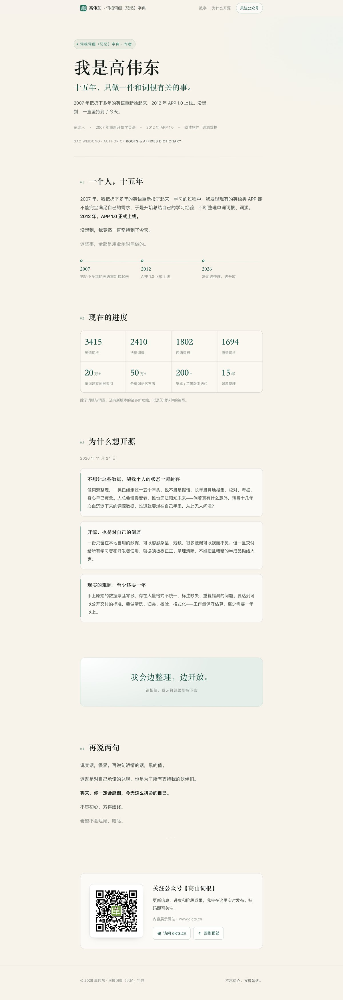

# 高伟东 · 词根词缀（记忆）字典

我是高伟东，APP【[词根词缀（记忆）字典](https://www.dicts.cn)】的研发者，东北人。

2007 年，我把扔下多年的英语重新捡起来。学习的过程中，发现现有的英语类 APP 都不能完全满足我的需求，
于是开始总结自己的学习经验，不断整理单词词根、词源。**2012 年，APP 1.0 正式上线。**

没想到，我竟然一直坚持到了今天。

## 现在的进度

| | |
|---|---|
| 3415 | 英语词根 |
| 2410 | 法语词根 |
| 1802 | 西语词根 |
| 1694 | 德语词根 |
| 20 万+ | 单词建立了词根索引 |
| 50 万+ | 条单词记忆方法 |
| 200+ | 安卓 / 苹果版本迭代 |
| 15 年 | 词源整理 |

除了词根与词源，还有新版本的诸多新功能，以及阅读软件的编写。**这些都是利用所有业余时间完成的。**

说实话，很累。再说句矫情的话，累的值。

## 为什么想开源

**不想让这些数据，随我个人的状态一起封存。**
做词源整理，一晃已经走过十五个年头。长年累月地搜集、校对、考据，身心早已疲惫。人总会慢慢变老，
谁也无法预知未来——倘若真有什么意外，耗费十几年心血沉淀下来的这些词源数据，难道就要烂在自己手里，
从此无人问津？

**开源，也是对自己的倒逼。**
一份只留在本地自用的数据，可以容忍杂乱、残缺；但一旦交付给所有学习者和开发者使用，就必须板板正正、
条理清晰，不能把乱糟糟的半成品抛给大家。

**现实的难题：至少还要一年。**
手上原始的数据杂乱零散，格式不统一、标注缺失、重复错漏，要做清洗、归类、校验、格式化，
工作量保守估算至少需要一年以上。

> ### 我会边整理，边开放。
> 请相信，我必将继续坚持下去，不仅仅是对自己承诺的兑现，也是为了所有支持我的伙伴们。

将来，你一定会感谢，今天这么拼命的自己。
不忘初心，方得始终。

希望不会烂尾，哈哈。

## 关注

- 微信公众号：**高山词根**（更新信息、进度和阶段成果，在这里实时发布）
- 内容展示网站：[www.dicts.cn](https://www.dicts.cn)

© 2026 高伟东
