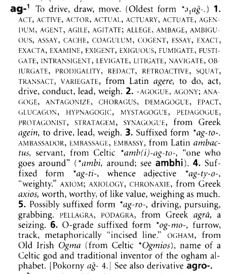
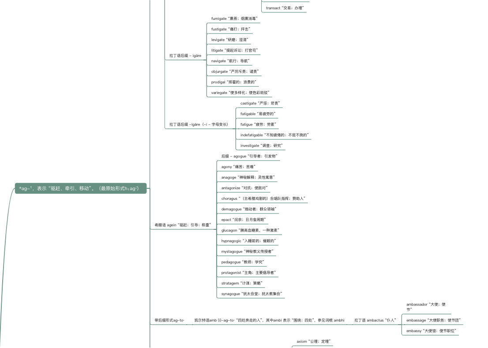

# AHDR 印欧词根 *ag-¹ 词族整理说明

> 以《美国传统英语字典》（The American Heritage Dictionary of the English Language，AHDR）为依据制作的思维导图，以及为便于中文阅读而逐词附加的释义。

## 一、资料来源与构成

| 项目 | 说明 |
| --- | --- |
| 依据条目 | AHDR 印欧词根附录：`*ag-¹` "To drive, draw, move" |
| 原始资料下载 | https://pan.quark.cn/s/c171a15b5d9e （夸克网盘） |
| 示例思维导图 | `readme1.png`（见三） |
| 示例字典原文 | `readme2.png`（见二） |
| 中文释义 | 整理者附加，便于理解；非字典原文翻译 |

## 二、示例-原文

## 三、示例-思维导图

导图层级为：**中心词根 → 来源语言 / 构词成分 → 派生词**。

## 四、说明与注意事项

1. **中文释义是我（高伟东）附加**的通俗译法，AHDR 原文仅提供英文释义与词源链，中文部分不属于字典原文。
2. posm是WPS导出的思维导图，txt是对应的中文说明。
